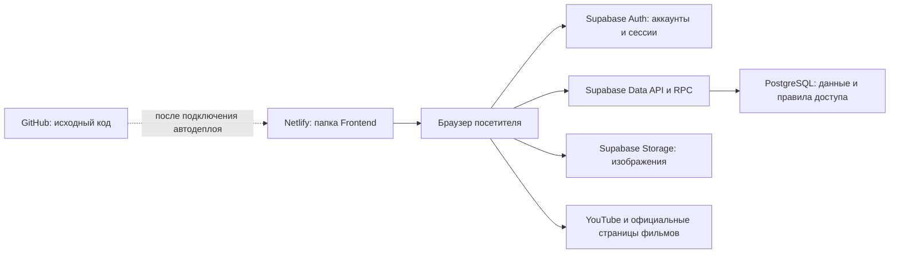

# CineMax: устройство проекта и руководство

> Обновление 19 октября: [дневник, статистика, новые фильтры, фильмы и порядок включения](UPGRADE-JOURNEY.md). Ниже сохранён снимок предыдущей версии от 15 октября; новые функции нельзя считать включёнными в облаке до применения миграций.

Состояние на **15 октября 2026 года**. Документ описывает текущий вариант **Netlify + Supabase**, а также границы выполненных проверок.

## 1. Что представляет собой CineMax

CineMax — сайт для поиска фильмов, чтения отзывов, сохранения избранного и совместного выбора фильма с друзьями. Отличительные возможности: подбор по настроению и времени, гостевые комнаты Movie Match, скрытие спойлеров по отметке автора.

Это каталог с трейлерами и ссылками на открытые фильмы. Сайт не содержит собственного видеосервиса с коммерческими фильмами и не предоставляет подписку на их просмотр.

Основные адреса:

- Сайт: <https://willowy-treacle-e1845e.netlify.app/>
- Исходный код: <https://github.com/Shakon53/cinemax-movie-system>, ветка `master`.
- Панель Supabase: <https://supabase.com/dashboard/project/gvifasloexjfhzdokgoq>
- История публикаций Netlify: <https://app.netlify.com/sites/willowy-treacle-e1845e/deploys>

Адрес `cinemax-….netlify.app` пока не подтверждён. Название проекта Supabase не определяет адрес сайта.

## 2. Что есть и что проверено

«Реализовано» означает, что функция присутствует в исходном коде. Это не заменяет проверку конкретной версии, опубликованной в Netlify.

| Возможность | Состояние и ограничения |
| --- | --- |
| Каталог | Реализован. В облачной базе 12 опубликованных фильмов и 3 черновика. |
| Поиск и фильтры | Название/описание, жанр, год, сортировка по рейтингу, году или названию. Устаревший ответ поиска не перезаписывает более новый. |
| Подбор под вечер | Настроение, максимальная длительность, насыщенность и доступность бесплатно. Используются редакционные метки, без ИИ. |
| Случайный фильм | Выбирается с учётом выбранных условий. |
| Движущиеся постеры | Три колонки на главной, автоматический запуск, противоположные направления. Карточки ведут к фильмам; есть ручная пауза. |
| Карточка фильма | Описание, характеристики, актёры, отзывы, рейтинги и похожие фильмы. Трейлер загружается после нажатия. |
| Регистрация | Реальный запрос `/signup` завершился успешно; создан один аккаунт, отмечена отправка письма. Email этого аккаунта ещё не подтверждён. |
| Вход и выход | Реализованы через Supabase Auth; положительный вход реального подтверждённого аккаунта пока не проверен. |
| Восстановление пароля | Реализовано через письмо и `reset.html`; доставка письма и полный пользовательский сценарий не подтверждены. |
| Избранное | Гостевое — в браузере; для вошедшего пользователя — в Supabase. Изоляция аккаунтов проверена автотестами. |
| Отзывы | В облаке сохранено 6 отзывов. Новые отзывы привязаны к вошедшему пользователю; оценка 1–10, текст до 2000 символов. |
| Спойлеры | Автор ставит отметку; текст скрывается до раскрытия. Автоматическое распознавание отсутствует. |
| Movie Match | Комнаты на 2–8 участников без обязательного аккаунта. Проверены права создателя, голоса, единогласные совпадения и срок действия. |
| Бесплатные фильмы | Big Buck Bunny и Sintel: ссылки на официальные страницы авторов и сведения о лицензии. |
| Админка | Реализована; права проверяются в базе, а не только в браузере. Вход реального администратора ещё не подтверждён. |
| Мобильное меню | Добавлены кнопки открытия меню на внутренних страницах. Визуальная проверка на реальных устройствах ещё нужна. |
| Языки и тема | Есть EN/RU/KZ и светлая/тёмная тема. Переведена часть интерфейса; отдельные страницы и подписи остаются смешанными. |

Старые данные сохранены: 13 карточек фильмов, 6 отзывов и 4 записи старых пользователей. Три тестовые карточки скрыты в черновиках; добавлены два открытых фильма. Старые пароли не импортированы в Supabase Auth — нужна новая регистрация.

## 3. Как всё связано



**Netlify** отдаёт HTML, CSS и JavaScript. Отдельного процесса приложения на VPS в текущей схеме нет.

**Браузер** выполняет JavaScript и обращается напрямую к Supabase через SDK. Публичный ключ в `js/config.js` определяет проект, но не выдаёт права администратора.

**Supabase Auth** отвечает за регистрацию, подтверждение email, сессии, вход и восстановление пароля. **PostgreSQL** хранит каталог и пользовательские данные. Правила RLS ограничивают доступ к строкам независимо от того, что пользователь меняет в браузере.

**GitHub** хранит код и SQL-миграции. Последнее обновление кода сохранено в `master`. Связь GitHub → Netlify автоматически не подтверждена: при проверке последнего программного коммита не было статусов публикации или запусков GitHub Actions. Сам коммит не доказывает обновление сайта.

Папка `MovieManagement.API` содержит альтернативный backend на ASP.NET Core 8. В режиме `CINEMAX_BACKEND = 'supabase'` сайт его не использует. Настройки AWS, Docker, Caddy и Render относятся к этому альтернативному варианту.

## 4. Карта файлов

| Путь | Назначение |
| --- | --- |
| `Frontend/index.html` | Главная, поиск, фильтры и каталог. |
| `Frontend/movie.html` | Страница конкретного фильма: `movie.html?id=1`. |
| `Frontend/actors.html`, `director.html` | Актёры и страница режиссёра. |
| `Frontend/auth.html` | Регистрация и вход обычного пользователя. |
| `Frontend/reset.html` | Установка нового пароля после письма восстановления. |
| `Frontend/favorites.html`, `reviews.html` | Избранное и отзывы. |
| `Frontend/match.html` | Создание комнаты и совместное голосование. |
| `Frontend/free.html` | Открытые фильмы с официальными ссылками. |
| `Frontend/login.html`, `admin.html` | Вход администратора и управление данными. |
| `Frontend/js/config.js` | Режим backend, URL проекта и публичный ключ Supabase. |
| `Frontend/js/api.js` | Общий интерфейс запросов, форматирование, безопасное отображение текста и URL. |
| `Frontend/js/supabase-api.js` | Преобразование запросов страниц в операции Supabase. |
| `Frontend/js/auth-helper.js`, `favorites.js` | Меню аккаунта и логика избранного. |
| `Frontend/js/discovery.js`, `match.js` | Фильтры настроения и комнаты друзей. |
| `Frontend/js/hero-mosaic.js` | Загрузка постеров и управление движением колонок. |
| `Frontend/js/i18n.js` | Словари и переключение языка. |
| `Frontend/css/style.css` | Основной стиль CineMax. |
| `Frontend/css/features.css`, `hero-mosaic.css` | Дополнительные функции и анимированный первый экран. |
| `Frontend/vendor/` | Локальная копия Supabase SDK и его лицензия. |
| `supabase/migrations/`, `supabase/seed.sql` | Структура базы, правила доступа и начальный каталог. |
| `tests/` | Автотесты клиента и правил PostgreSQL. |
| `netlify.toml` | Публикация папки `Frontend`, заголовки и страница 404. |
| `Frontend/_headers`, `_redirects` | Настройки для ручной загрузки папки в Netlify. |
| `SETUP-SUPABASE.md` | Подробная первоначальная настройка backend. |

Frontend работает без сборки, React и npm-сервера. Bootstrap и его иконки загружаются с CDN; постеры преимущественно используют внешние адреса. Их доступность влияет на отображение картинок и отдельных элементов интерфейса.

## 5. Где хранятся данные

### Облачная база

| Таблицы | Данные |
| --- | --- |
| `movies` | Фильмы, ссылки, метки настроения, насыщенность, публикация/черновик. |
| `genres`, `countries`, `directors`, `actors` | Жанры, страны, режиссёры, актёры. |
| `movieactors`, `ratings`, `discounts`, `boxoffice` | Связи с актёрами и дополнительные сведения. |
| `auth.users` | Учётные записи, которыми управляет Supabase Auth. |
| `profiles` | Публичный профиль: идентификатор и имя пользователя. |
| `user_roles` | Серверные роли, включая администратора. |
| `reviews` | Автор, фильм, текст, оценка, дата, отметка спойлеров. |
| `favorites` | Связи между аккаунтом и избранными фильмами. |
| `cinemax_private.rooms`, `members`, `votes` | Комнаты, ключи участников и голоса. |
| `cinemax_private.initial_admin` | Однократное назначение первого администратора. |

Старые таблицы с заглавными именами, например `Movies` и `Users`, сохранены после переноса. Браузерный доступ к ним закрыт; новый сайт работает с таблицами в нижнем регистре.

### Хранилище изображений

Бакет `posters` предназначен для JPEG, PNG и WebP до 5 МБ. Просмотр публичный, запись разрешена администраторам. Сейчас файл загружается через Supabase Storage, затем его URL вставляется в админке. Форма загрузки файла непосредственно на сайте не реализована. Полнометражные видео в этот бакет не загружаются.

### Данные браузера

- `localStorage`: выбранные язык и тема, гостевое избранное, кеш отображаемых данных пользователя. SDK также сохраняет сессию Auth.
- `sessionStorage`: ключ участника Movie Match и код комнаты. Закрытие вкладки может привести к потере этого ключа.
- Гостевое избранное не переносится в аккаунт автоматически. Оно привязано к браузеру и адресу сайта; при смене домена не мигрирует само.
- Кеш `cinemax_user` и отметка `cinemax_admin` не являются доказательством прав: решающая проверка выполняется Supabase.

## 6. Как пользоваться

### Подобрать фильм

Откройте главную, задайте поиск или жанр. Для более точного выбора раскройте «Подобрать по настроению и времени». Кнопка «Выбрать за меня» учитывает текущие условия. Нажатие на постер открывает подробную карточку.

### Зарегистрироваться

1. Откройте `auth.html` и вкладку Register.
2. Введите имя: 3–40 латинских букв, цифр, знаков `_` или `-`.
3. Укажите email и пароль от 10 символов, повторите пароль.
4. Откройте письмо подтверждения. После подтверждения войдите на сайте.

Отсутствие мгновенного входа после регистрации ожидаемо, когда включено подтверждение email. По последней проверке один аккаунт создан, письмо отмечено как отправленное, подтверждение ещё не выполнено. Это не доказывает доставку во входящие.

Для массовой регистрации нужно проверить SMTP и разрешённые адреса возврата. Стандартная почта Supabase ограничивает получателей адресами участников команды проекта; для остальных нужен собственный SMTP. См. [официальное описание SMTP](https://supabase.com/docs/guides/auth/auth-smtp).

### Сохранить фильм и написать отзыв

Сердце на карточке добавляет фильм в избранное. У гостя список хранится локально, у вошедшего пользователя — в базе. Отзывы публикуются от текущего аккаунта; ввод имени другого человека не меняет автора. Спойлеры скрываются только при установленной автором отметке.

### Выбрать с друзьями

1. Откройте «Выбрать с друзьями», введите имя и создайте комнату.
2. Скопируйте приглашение или передайте код. Друзья входят со своих устройств.
3. Когда собрались 2–8 человек, создатель нажимает «Начать».
4. Каждый выбирает «Нравится» или «Не нравится». Совпадение появляется, если фильм понравился всем участникам.

Комната действует 2 часа. После начала новые участники не добавляются; список кандидатов фиксируется, максимум 40 фильмов. Обновление состояния происходит примерно раз в 4 секунды в активной вкладке. Это выбор фильма, без синхронного совместного видеопросмотра.

## 7. Администрирование и защита

Администратор может управлять фильмами и актёрами, просматривать таблицы и пользователей, удалять записи через предусмотренные операции. Для фильма доступны ссылки на постер/трейлер/открытый просмотр, лицензия, атрибуция, настроение, метки, насыщенность и публикация.

Первый администратор назначается по заранее зарезервированному email после реального подтверждения почты. Требуются отметки об отправке и подтверждении письма; простой ввод чужого email и роль в метаданных регистрации не дают доступ. Конкретный адрес и секреты в этом документе не публикуются.

Для последующего назначения администратора владелец проекта использует доверенный SQL Editor по инструкции в `SETUP-SUPABASE.md`. Обычный посетитель не может изменить `user_roles` публичным ключом.

Применённые ограничения:

- RLS: чужое избранное недоступно; запись отзывов привязана к текущему пользователю.
- Каталог изменяет администратор; гости читают опубликованные карточки.
- Старые аккаунты и хеши паролей закрыты от браузера.
- В комнатах используется отдельный секретный ключ участника; в приглашение входит только код комнаты.
- Текст отзывов экранируется; для внешних ссылок допускается HTTPS, для трейлеров — поддерживаемые форматы YouTube.
- `service_role`, secret key, пароль БД и SSH-ключи нельзя размещать в `Frontend`, документации или публичном репозитории.

Автотесты подтверждают конкретные ограничения, но не заменяют полный независимый аудит безопасности.

## 8. Как сохранять и публиковать изменения

| Что изменено | Что делать |
| --- | --- |
| HTML, CSS, JavaScript | Сохранить код в GitHub и опубликовать `Frontend` в Netlify. |
| Только документация | Сохранить файлы в GitHub; работающий сайт обновлять не требуется. |
| Фильмы и отзывы через сайт/админку | Изменения сохраняются напрямую в Supabase, новая публикация frontend не нужна. |
| SQL-структура и политики | Подготовить миграцию, проверить и применить к Supabase; сохранить SQL в GitHub. |
| SMTP, Auth URL | Изменить настройки проекта Supabase; они не применяются загрузкой HTML. |

### Ручная публикация Netlify

Загрузите папку `Frontend` в Deploys существующего проекта. В корне загружаемой папки должен находиться `index.html`. ZIP предварительно распакуйте. Не загружайте весь репозиторий: backend, тесты и SQL не должны становиться публичной папкой сайта.

Дождитесь статуса Published и проверьте сайт с обновлением кеша (`Ctrl + F5`). Старые архивы в `artifacts` — снимки прежних версий, они не обновляются автоматически при редактировании исходников.

### Автоматическая публикация из GitHub

В существующем проекте Netlify подключите репозиторий `Shakon53/cinemax-movie-system`, выберите ветку `master`, оставьте команду сборки пустой и укажите publish directory `Frontend`. Конфигурация уже описана в `netlify.toml`.

После подключения новое изменение в `master` должно создавать публикацию Netlify. Проверяйте результат в Deploys; сам успешный коммит GitHub не означает успешный деплой. Подключение этой автоматизации на момент документации не подтверждено.

### Смена бесплатного адреса

Измените имя проекта в Netlify на доступное `cinemax-…`. После смены задайте новый Site URL и разрешите точные адреса `/auth.html` и `/reset.html` в Supabase → Authentication → URL Configuration. Проверьте новые письма подтверждения и восстановления. Пользовательские данные облачной базы останутся в том же проекте.

## 9. Проверки и запуск разработки

Для работы сайта сборка не нужна. Для тестов используйте Node.js; последняя локальная проверка выполнена на Node.js 24:

```powershell
npm ci
npm test
```

Тесты используют встроенный тестовый запускатель Node и PGlite — PostgreSQL для локальной проверки SQL. Последний полный запуск: **14 тестов прошли**.

Проверяются синтаксис, локальные ресурсы, обработчики кнопок/ошибок изображений, регистрация с подтверждением, видимые сообщения входа, защита от устаревшего ответа поиска, трейлеры, привязка отзывов к пользователю, права на каталог, изоляция избранного, комнаты и истечение их срока.

Для локального просмотра используйте HTTP-сервер, например расширение Live Server редактора, с корнем `Frontend`. При проверке писем добавьте фактические локальные адреса Auth в список разрешённых возвратов Supabase. Двойной клик по HTML не заменяет проверку сайта через HTTP.

Что дополнительно проверено в облаке: запрос регистрации с кодом 200, наличие созданной учётной записи, состояние подтверждения, количество фильмов/отзывов и закрытость старых пользовательских данных. Страницы главной, входа, восстановления, фильма, избранного и комнат отвечали HTTP 200. Ответ 200 подтверждает выдачу страницы, но не выполнение всех действий внутри неё.

Что ещё не подтверждено: полный вход реального подтверждённого пользователя и администратора, доставка/переход по письмам восстановления, внешний вид в доступном браузере и на устройствах, автоматический деплой Netlify. Подключённого браузера для визуальной проверки не было.

## 10. Частые проблемы

| Симптом | Что проверить |
| --- | --- |
| После регистрации не вошёл | Подтверждение email. Созданная запись ещё не означает подтверждённый аккаунт. |
| Письмо не пришло | Спам, правильность адреса, Auth Logs, SMTP и ограничения стандартной почты Supabase. Не повторяйте отправку непрерывно: действуют лимиты. |
| Ссылка из письма ведёт не туда | Site URL и Redirect URLs в Supabase, включая протокол и фактический домен. |
| После коммита старый дизайн | Состояние Deploys, подключённый репозиторий, ветка, папка `Frontend`, кеш браузера. |
| Карточки не движутся | Версия опубликованных `hero-mosaic.js`/CSS, ручная пауза, загрузка каталога и ошибки JavaScript. Браузер может замедлять анимацию фоновой вкладки. |
| Нет фильмов | Соединение с Supabase, состояние проекта, заполненный `config.js`, выбранные фильтры. |
| Избранное отличается на устройствах | Войдите в один аккаунт; гостевой список не синхронизируется. |
| Не пускает в админку | Подтверждённый email и роль в `user_roles`; localStorage права не выдаёт. |
| Комната перестала работать | Срок 2 часа, сохранность вкладки и ключа `sessionStorage`, соединение. После начала новые участники не входят. |
| Сломан постер или трейлер | Внешний URL, доступность источника, корректный YouTube ID. У картинок предусмотрена обработка ошибок. |

## 11. Доступность, резервные копии и следующие задачи

Выключение компьютера владельца не останавливает опубликованный frontend и облачную базу. При этом бесплатные тарифы не дают гарантии непрерывной работы 24/7: Supabase может приостановить проект при низкой активности, Netlify — при исчерпании квот. Актуальные правила: [Supabase](https://supabase.com/docs/guides/platform/free-project-pausing), [Netlify](https://docs.netlify.com/manage/accounts-and-billing/billing/resume-paused-projects/).

GitHub сохраняет исходники и миграции, но не является резервной копией текущих отзывов, аккаунтов, избранного или Storage. Для этих данных требуется отдельный экспорт/резервное копирование. Перед переносом была сделана локальная копия старых записей вне репозитория; её наличие не означает регулярные автоматические резервные копии.

Приоритет следующих работ:

1. Завершить проверку почты, подтверждения, входа и восстановления пароля.
2. Проверить администратора, подключить и подтвердить автодеплой Netlify.
3. Проверить сайт на телефоне и настольном браузере.
4. Завершить локализацию, расширять каталог и редакционные метки.
5. Настроить резервные копии и наблюдение за ошибками и квотами.

Пока не реализованы: персональные рекомендации ИИ, автоматический анализ спойлеров, платёжная подписка, полноценный трекер «Просмотрено», статистика личного просмотра, автоматический импорт TMDb, региональный агрегатор «Где посмотреть» и синхронный совместный видеопросмотр.
